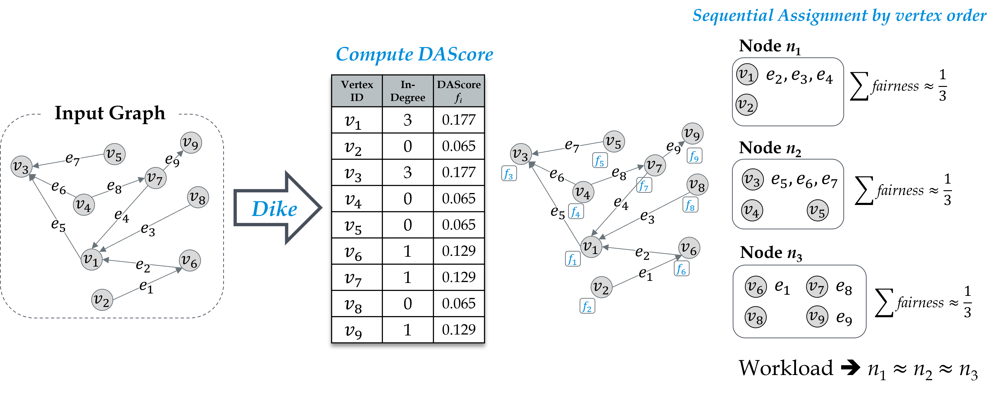

# Dike: Degree-Aware Fairness Score for Graph Partitioning

Dike is a workload-balanced graph partitioning method for distributed graph processing on power-law graphs. It introduces the **Degree-Aware Fairness Score (DAscore)**, which estimates each vertex's relative computational cost and enables balanced assignment across nodes — even when degree distributions are highly skewed.

This repository contains the distributed PageRank implementation used to evaluate Dike's partitioning quality under a **hybrid MPI + RDMA communication model**.

> **Abstract:** This paper addresses the partitioning problem of large-scale graphs in distributed environments. Existing count-based and degree-based approaches fail to guarantee workload balance in power-law graphs because each vertex incurs a different computational cost. We propose the *fairness score* to estimate per-vertex workload, and the *Degree-Aware Fairness Score (DAscore)* to achieve optimal workload balance even in power-law graphs. Dike assigns vertices sequentially using DAscore without global sorting or ID reordering, reducing partitioning overhead. Experimental results show that Dike effectively alleviates workload imbalance and achieves up to **77.8× faster execution** than existing partitioning methods.




## Project Structure

```
.
├── CMakeLists.txt
├── DIKE.cpp                          # Entry point: MPI+RDMA PageRank driver
├── includes/
│   ├── lib/
│   │   └── pagerank.hpp              # Pagerank class interface
│   ├── network/
│   │   ├── myRDMA.hpp                # High-level RDMA wrapper interface
│   │   ├── RDMA.hpp                  # Low-level InfiniBand verbs interface
│   │   └── tcp.hpp                   # TCP bootstrap interface
│   └── threadpool/
│       └── threadpool.hpp
├── src/
│   ├── lib/
│   │   └── pagerank.cpp              # Dike partitioning + PageRank computation
│   ├── network/
│   │   ├── myRDMA.cpp                # RDMA collective ops (send/recv/write)
│   │   ├── RDMA.cpp                  # InfiniBand verbs wrappers
│   │   └── tcp.cpp                   # TCP server/client for QP info exchange
│   └── threadpool/
│       └── threadpool.cpp
└── roce_test/                        # RoCE (RDMA over Converged Ethernet) test suite
    ├── main.cpp
    ├── includes/network/
    │   ├── D_RDMALib.hpp
    │   ├── D_RoCELib.hpp
    │   ├── RDMA.hpp
    │   └── tcp.hpp
    └── src/network/
        ├── D_RDMALib.cpp
        ├── D_RoCELib.cpp
        ├── RDMA.cpp
        └── tcp.cpp
```

---

## Prerequisites

| Dependency | Notes |
|---|---|
| InfiniBand HCA or RoCE NIC | RDMA-capable hardware required |
| `libibverbs` | InfiniBand verbs library |
| `librdmacm` | RDMA connection manager |
| MPI (e.g. OpenMPI) | `mpic++` must be in PATH |
| OpenMP | Bundled with GCC / Clang |
| CMake ≥ 3.5 | Build system |
| C++17 | Compiler support required |

---

## Configuration

Before building, set your cluster topology in `DIKE.cpp`:

```cpp
#define NUM_NODES   5               // Total number of nodes (coordinator + compute)
#define TCP_PORT    40145           // TCP port for RDMA QP info exchange
#define SERVER_IP   "192.168.4.5"  // Coordinator node IP

static const std::string NODE_IPS[NUM_NODES] = {
    SERVER_IP,        // index 0 = coordinator (no computation)
    "192.168.4.10",   // index 1..N-1 = compute nodes
    "192.168.4.12",
    "192.168.4.13",
    "192.168.4.9"
};
```

Also verify the NIC interface names in `src/network/tcp.cpp` → `check_my_ip()`:

```cpp
const char* rdma_nics[] = { "ibp2s0", "ibs6", "enp5s0", "enp6s0", nullptr };
```

Add your NIC interface name to this array if it is not listed.

---

## Build

```bash
mkdir build && cd build
cmake ..
make -j$(nproc)
```

---

## Usage

```bash
mpirun -np <procs_per_node> --hostfile hosts ./pagerank \
    <graph_file> <delimiter> <partition_strategy> <alpha>
```

### Arguments

| Argument | Description |
|---|---|
| `graph_file` | Path to edge list file (one directed edge per line) |
| `delimiter` | Field separator: `" "` (space) or `"\t"` (tab) |
| `partition_strategy` | Partitioning method (integer 1–7, see below) |
| `alpha` | Power-law exponent for DAscore (used when `partition_strategy=7`) |

### Partition Strategies

| Value | Name | Weight Function | Notes |
|---|---|---|---|
| `1` | Equi-vertex | `w = 1` | Uniform vertex count per node |
| `2` | Square root | `w = √degree` | Moderate degree skew reduction |
| `3` | Log | `w = log(degree + 1)` | Stronger skew reduction |
| `4` | Equi-edge | `w = degree + 1` | Uniform edge count per node |
| `5` | Log+e | `w = log(degree + e)` | Variant of Log |
| `6` | Log+E | `w = log(degree + E)` | Adaptive variant |
| `7` | **DAscore (Dike)** | `w = 1 + √(degree^α) × sigmoid(degree)` | **Proposed method** — degree-aware fairness score |

Strategy `7` is the proposed Dike method. The `alpha` argument controls the sensitivity of DAscore to high-degree vertices.

### Example

```bash
# Run Dike (DAscore) with alpha=0.5, 2 MPI ranks per node
mpirun -np 2 --hostfile hosts ./pagerank graph.txt " " 7 0.5

# Run baseline equi-vertex partitioning
mpirun -np 2 --hostfile hosts ./pagerank graph.txt " " 1 1.0
```

---

## Graph Format

Plain text edge list, one directed edge per line. Vertex IDs must be non-negative integers.

```
# Space-delimited
0 1
0 2
1 3

# Tab-delimited
0	1
0	2
1	3
```

---

## Output

Results are written to both stdout and `output.txt`:

```
===================================================
[INFO] SORTING PAGERANK VALUE.
PR[1234567]: 0.000004123...
PR[8901234]: 0.000003891...
...
===================================================
[INFO] AVG COMPUTE TIME:     0.312s
[INFO] AVG MPI TIME:         0.021s
[INFO] AVG RDMA TIME:        0.008s
[INFO] TOTAL EXECUTION TIME: 6.701s
```

Per-step timing is also printed to stdout, allowing comparison of compute vs. communication overhead across partition strategies.

---

## Notes

- The **coordinator node** (index 0 in `NODE_IPS`) performs no PageRank computation. It only aggregates and redistributes the PR vector over RDMA.
- **Convergence** is detected on the coordinator by tracking the L1 diff of the PR vector across steps. The threshold is `1e-5`. `MAX_ITERATIONS` (default: 20) can be adjusted in `DIKE.cpp`.
- **RoCE test** (`roce_test/`) is a standalone suite for validating RDMA connectivity over Ethernet before running the full experiment.


